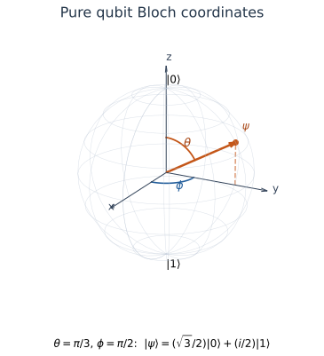

# 3. Single-Qubit States and Rotations

**Working draft: sections 3.1–3.4 · Writing Baseline 1.0 · October 21, 2026.** Author execution is recorded separately from independent mathematical, implementation and reader review, all pending. This is not an accepted chapter. Examples use released FlagQuantum 0.3.1 and PyTorch 2.13.0 on CPU with complex128 statevectors.

<span id="sec-single-qubit-states-and-rotations-1"></span>

## 3.1 The pure-state postulate and physical equivalence

A simulator stores an array. A physical state is not identified with every detail of that array: multiplying every amplitude by the same complex number of modulus one changes the array but preserves the pure state it represents. We need a precise rule for this equivalence before deciding whether two simulation outputs agree.

The prerequisite is [2.2 Inner products, adjoints, and orthogonality](ch-complex-vectors-operators-and-numerical-reasoning.md#sec-complex-vectors-operators-and-numerical-reasoning-2), including its Cauchy–Schwarz equality condition. We introduce the physical assumptions here; they do not follow from linear algebra. By the end, you should be able to distinguish vector equality, pure-state equivalence and agreement of probabilities in one measurement setting.

### The postulates: a unit vector, an equivalence, and an outcome rule

For an ideal qubit described by a **pure state**, the state space is the two-dimensional complex inner-product space $\mathbb C^2$. Pure states are the scope of this section, not a claim that every physical qubit always has such a description. Correlations with an environment and uncertain preparations will require a more general description later.

Fix two orthonormal vectors, called the **computational basis**, with the coordinate convention

$$
|0\rangle=\begin{pmatrix}1\\0\end{pmatrix},\qquad
|1\rangle=\begin{pmatrix}0\\1\end{pmatrix}.
$$

A **ket** $|\psi\rangle$ denotes a column vector. Its **bra** $\langle\psi|$ is the conjugate transpose introduced in 2.2. Here the digits label basis vectors and eventual measurement outcomes; they are not the amplitudes. State our restricted postulates as follows:

1. A pure qubit state has a unit-vector representative $|\psi\rangle=\alpha|0\rangle+\beta|1\rangle$, with complex amplitudes $\alpha,\beta$ and $\langle\psi|\psi\rangle=1$.
2. Unit vectors $|\psi\rangle$ and $u|\psi\rangle$ represent the same pure state whenever $|u|=1$. The common multiplier is a **global phase**. Equivalently, $u=e^{i\theta}$ for a real angle $\theta$.
3. An ideal computational-basis measurement returns a label $b\in\{0,1\}$ with **Born probability** $p(b)=|\langle b|\psi\rangle|^2$.

The equivalence class of representatives is often called a **ray**. We use normalized representatives, so the allowed multiplier between them has modulus one. A ray can also be specified by a nonzero unnormalized vector, but that vector must first be normalized before using the probability formula above.

These are physical modeling rules. The first two specify a state description; the third connects that description to observations. A computational-basis probability pair alone does not establish the second rule for all possible experiments. Chapter 6 will introduce general measurement rules and the state after measurement; neither is assumed in the derivations below.

### Deriving the normalization and probabilities

Expand the unit-norm condition using orthonormality. The cross terms vanish because $\langle0|1\rangle=\langle1|0\rangle=0$, and each basis vector has norm one:

$$
\begin{aligned}
\langle\psi|\psi\rangle
&=(\alpha^*\langle0|+\beta^*\langle1|)
  (\alpha|0\rangle+\beta|1\rangle)\\
&=|\alpha|^2+|\beta|^2=1.
\end{aligned}
$$

Likewise $\langle0|\psi\rangle=\alpha$ and $\langle1|\psi\rangle=\beta$. Substituting into the outcome postulate gives

$$
p(0)=|\alpha|^2,\qquad p(1)=|\beta|^2,\qquad p(0)+p(1)=1.
$$

Nonnegativity follows from squared complex moduli. The sum-one statement is a consequence of normalization and orthonormality, not an additional independent postulate. For example, $\alpha=\sqrt3/2$ and $\beta=i/2$ give probabilities $3/4$ and $1/4$. The imaginary amplitude contributes a positive probability, since $(i/2)^*(i/2)=(-i/2)(i/2)=1/4$.

In the code, this coordinate calculation becomes:

```python
u = torch.tensor([sqrt(3)/2, .5j], dtype=torch.complex128)
probabilities = u.abs().square()  # [0.75, 0.25]; not u.square()
```

For a nonzero raw vector $v=(a,b)^T$, a unit representative is $v/\sqrt{|a|^2+|b|^2}$. Dividing $(1,i)^T$ by $\sqrt2$ is a choice of normalized description, not a laboratory preparation procedure. The zero vector cannot represent a state because no division can make its norm one. Our executable comparison rejects unnormalized inputs instead of silently repairing them.

### Global phase invariance, with its logical limit

Let $|\phi\rangle=u|\psi\rangle$ with $|u|=1$. Both normalization and the computational-basis probabilities are unchanged:

$$
\langle\phi|\phi\rangle=u^*u\langle\psi|\psi\rangle=1,
\qquad
|\langle b|\phi\rangle|^2=|u\langle b|\psi\rangle|^2
=|u|^2p(b)=p(b).
$$

This checks consistency with our restricted measurement rule. It does **not** prove that any two vectors with the same probability pair are equivalent. To see the missing information, compare

$$
|\psi\rangle=\frac1{\sqrt2}\begin{pmatrix}1\\i\end{pmatrix},\qquad
|\phi\rangle=i|\psi\rangle=\frac1{\sqrt2}\begin{pmatrix}i\\-1\end{pmatrix},\qquad
|\chi\rangle=\frac1{\sqrt2}\begin{pmatrix}1\\-i\end{pmatrix}.
$$

All three give $(p(0),p(1))=(1/2,1/2)$. The first two differ by a common multiplier $i$. The first and third cannot: their nonzero first coordinates require a multiplier $1$, while their second coordinates require $-1$. Their **relative phase** differs. Section 3.2 will show how a subsequent interference experiment can reveal the difference. Here we only establish that they are different rays under the stated rule.

“Global” applies to the entire vector being compared. Changing the sign of only one amplitude is not global. Nor should a phase attached to one branch of a larger state be discarded as if it multiplied the entire larger state.

### A phase-aware comparison derived from the inner product

For two unit vectors $a,b$, define their overlap $c=\langle a|b\rangle$. If $b=ua$ with $|u|=1$, then $c=u$. Cauchy–Schwarz from 2.2 gives $|c|\leq1$, with equality exactly when the nonzero vectors are linearly dependent. Unit norms then force the dependence multiplier to have modulus one. Therefore, in exact arithmetic,

$$
a\text{ and }b\text{ represent the same pure state}
\quad\Longleftrightarrow\quad |\langle a|b\rangle|=1.
$$

For a comparison in coordinates, align $b$ to $a$. For any $|z|=1$, expanding the squared distance gives

$$
\|a-zb\|^2=2-zc-z^*c^*=2-2\operatorname{Re}(zc).
$$

Since $\operatorname{Re}(zc)\leq|c|$, the smallest squared distance is $2-2|c|$. For $c\ne0$, choose $z=c^*/|c|$ to attain it. If $c=0$, every phase gives squared distance $2$; no phase can align these orthogonal vectors into equality. The implementation computes a residual directly:

```python
c = torch.vdot(a, b)                    # conjugates a, as the overlap requires
phase = c.conj() / c.abs() if c.abs().item() != 0 else 1.0
distance = torch.linalg.vector_norm(a - phase*b).item()
```

At zero overlap, `phase=1` is only a convention for evaluating the distance. It is not a claim of equivalence. For nearly zero overlap, the selected phase can be sensitive to roundoff, while the distance remains near $\sqrt2$. Near equivalence, directly subtracting $2-2|c|$ can also lose small differences through cancellation; the script uses the aligned residual, with an explicit absolute tolerance. A small residual is numerical evidence under that tolerance, not an exact mathematical identity.

For the three hand vectors, $\langle\psi|\phi\rangle=i$ and $\langle\psi|\chi\rangle=0$. The raw distance between $\psi$ and $\phi$ is $\sqrt2$, but the aligned distance is zero. The aligned distance between $\psi$ and $\chi$ stays $\sqrt2$. Omitting the conjugate in the alignment multiplier sends $i\psi$ to $-\psi$ and produces the wrong distance $2$.

### Runnable verification and expected output

The complete executable is [pure_states.py](https://github.com/FlagQuantum/modern-quantum-computing/blob/main/examples/foundations/pure_states.py). From the repository root in the [pinned example environment](https://github.com/FlagQuantum/modern-quantum-computing#run-the-examples):

```bash
python -m pip install -r requirements-examples.txt
python examples/foundations/pure_states.py
```

The script first checks the complex-coordinate example against explicit scalar arithmetic and the hand overlap values. It then runs the real-amplitude cases $H|0\rangle$ and $ZH|0\rangle$ in released FlagQuantum 0.3.1. These preparation gates are the earlier Chapter 1 preview; their general theory is not a prerequisite for the postulates here. Their independently specified reference coordinates are $(1,1)^T/\sqrt2$ and $(1,-1)^T/\sqrt2$.

The actual API-to-formula correspondence is:

| Formula or obligation | Executed code |
|---|---|
| Ideal one-qubit preparation | `fq.Circuit(1, dtype=torch.complex128)`, then `circuit.h(0)` and optionally `circuit.z(0)` |
| Ideal computational-basis probabilities | `fq.run(circuit, outputs=[fq.probabilities()], options=OPTIONS)` |
| Simulator representative for comparison | `result.statevector()[0]`, validated as a finite CPU complex128 unit vector of shape `(2,)` |
| Squared moduli and probability reference | `v.abs().square()`; direct reference pairs checked with `torch.testing.assert_close` |
| Global phase on a stored representative | `1j*v`; this is array arithmetic, not a submitted gate or physical experiment |
| Equivalence test with declared tolerance | `aligned_distance(v, 1j*v) < 1e-12` |

`OPTIONS` requires the PyTorch CPU complex128 statevector method and disallows backend fallback and approximation. Statevector inspection is a simulator diagnostic, not a physical-device readout. The script checks the raw batch shape `(1,2)` before selecting its single state.

Expected output in the author-tested environment:

```text
complex example: P(0)=0.500000000, P(1)=0.500000000
global i: raw distance=1.414213562, aligned distance=0.000000000
relative sign: same probabilities, aligned distance=1.414213562
FlagQuantum H: P(0)=0.500000000, P(1)=0.500000000
FlagQuantum H then Z: P(0)=0.500000000, P(1)=0.500000000
Unequal probabilities, zero overlap, and 6 invalid-input cases checked.
Scalar references and released FlagQuantum agree (atol=1e-12); no shots or hardware.
```

The absolute tolerance is $10^{-12}$ with zero relative tolerance for unit-scale coordinates/probabilities. The validator rejects zero norm, a scaled non-unit vector, wrong shape, complex64, NaN and infinity. A separate exact zero-overlap basis pair exercises the zero branch. These checks cover small specified inputs; they do not establish the postulates experimentally, verify a physical preparation, sample measurement frequencies or provide state tomography.

### Understanding checks and transfer problems

**3.1-A — Postulate or consequence?** Classify: (i) pure qubit representatives have unit norm; (ii) computational-basis probabilities sum to one; (iii) global-phase multiples represent the same state; (iv) vectors with the same computational-basis probabilities represent the same state.

**3.1-B — Normalize without inventing an operation.** For $v=(2,2i)^T$, find a unit representative and its probability pair. Is dividing the vector by its norm a demonstrated physical preparation? What fails for $v=0$?

**3.1-C — Repair the comparison.** A program computes $c=\langle a|b\rangle$ and compares $a$ with $(c/|c|)b$. Use $b=ia$ to diagnose the error and give the correct multiplier. What should it do when $c=0$?

**3.1-D — Transfer to a boundary state.** Are $(0,1)^T$ and $(0,-i)^T$ equivalent? Explain why their zero first coordinate cannot determine the phase. Contrast them with the two non-equivalent equal-probability vectors above.

### Answers

**A.** (i) and (iii) are our state-description postulates. (ii) follows by orthonormal expansion and the Born rule. (iv) is false: $\psi$ and $\chi$ have equal probability pairs but incompatible coordinate ratios. A computational-basis distribution contains less information than a pure-state ray.

**B.** The norm is $\sqrt8=2\sqrt2$, giving $(1,i)^T/\sqrt2$ and $(1/2,1/2)$. This converts a mathematical description; it gives no laboratory preparation protocol. The zero vector has norm zero and cannot be normalized.

**C.** Here $c=i$, so the wrong multiplier gives $i(ia)=-a$ and distance $2$. Use $c^*/|c|=-i$ instead. For zero overlap, division is undefined; any unit phase gives distance $\sqrt2$. Return that nonzero distance or compute it using a documented phase convention, never report equivalence.

**D.** They are equivalent with common multiplier $-i$. The equation $0=u0$ gives no constraint on $u$; the second coordinate determines it. For $\psi$ and $\chi$, both coordinates are nonzero and demand different multipliers. Looking at only one coordinate or only squared moduli misses that contradiction.

### Sources, limits, and next step

The assigned sources are Nielsen and Chuang, *Quantum Computation and Quantum Information*, 10th Anniversary Edition (2010), **§2.2.1, printed pp.80–81** (unit state vectors and a qubit), and **§2.2.3, printed pp.84–85**, especially Eq.(2.96) and the computational-basis example on p.85. These correspond to [NC:2.2.1 and NC:2.2.3 in the exact-source catalog](../references/proof-sources.md). For the global/relative-phase distinction, supplementary **§2.2.7, printed p.93** supplies the more general observational argument. Our restricted presentation states phase equivalence explicitly and derives only its fixed-basis consistency check here. The phase-alignment proof uses the earlier Cauchy–Schwarz equality condition, not a new physical postulate or an experimental result.

The physical assumptions apply to an ideal pure qubit with a fixed basis; general measurements, post-measurement states and mixed states remain outside this section. See the [section record](https://github.com/FlagQuantum/modern-quantum-computing/blob/main/book/section-records/3.1.json) for execution provenance and pending reviews. Continue with the working draft [3.2 Relative phase and interference](#sec-single-qubit-states-and-rotations-2), where a subsequent operation turns the information missing from one probability pair into an observable difference.

<span id="sec-single-qubit-states-and-rotations-2"></span>

## 3.2 Relative phase and interference

In 3.1 we found different pure states with identical computational-basis probabilities. How can a later experiment tell them apart? A measurement that reads the same squared moduli cannot recover the missing information. We first combine the amplitudes coherently, and then apply the probability rule.

The prerequisites are [3.1](#sec-single-qubit-states-and-rotations-1), for normalized pure states and Born probabilities, and [2.3](ch-complex-vectors-operators-and-numerical-reasoning.md#sec-complex-vectors-operators-and-numerical-reasoning-3), for linear maps, matrix order and basis coordinates. We will derive the complex interference term in full and identify when a chosen experiment can, or cannot, reveal relative phase. General evolution postulates, measurement updates and noise models remain for later sections.

### Specify the phase and the experiment

For nonzero amplitudes, write

$$
\alpha=r e^{ia},\qquad \beta=s e^{ib},\qquad
r,s>0,\quad r^2+s^2=1.
$$

Here $a,b$ are real phase angles in radians; $r,s$ are magnitudes. We use Euler's identity $e^{ix}=\cos x+i\sin x$. Adding $2\pi$ to an angle gives the same complex phase. Multiplying the whole vector by $e^{-ia}$ selects the representative

$$
|\psi_\phi\rangle=r|0\rangle+s e^{i\phi}|1\rangle,
\qquad \phi=b-a\pmod{2\pi}.
$$

The angle $\phi$ is a **relative phase in this specified basis**. A common phase shifts $a,b$ equally and leaves their difference unchanged. If either amplitude is zero, its phase is undefined; a phase assigned only to that absent component cannot affect the state. A relative phase also depends on the phase conventions for the basis vectors. We hold those conventions, the preparation and the analyzer fixed while varying $\phi$.

Our ideal experiment uses two explicitly defined linear maps:

$$
D(\phi)=\begin{pmatrix}1&0\\0&e^{i\phi}\end{pmatrix},
\qquad H=\frac1{\sqrt2}\begin{pmatrix}1&1\\1&-1\end{pmatrix}.
$$

$D$ changes only the outcome-1 amplitude. $H$, the Hadamard map, replaces amplitudes $\alpha,\beta$ by $(\alpha+\beta)/\sqrt2$ and $(\alpha-\beta)/\sqrt2$. These transfer rules specify the ideal preparation/analyzer model for this experiment. We are not deriving laboratory controls or assuming the general evolution theory of 3.4.

Both maps preserve normalization. For $D$, multiplying one coordinate by a number of modulus one preserves its squared modulus. For $H$, direct expansion gives

$$
\frac{|\alpha+\beta|^2+|\alpha-\beta|^2}{2}
=|\alpha|^2+|\beta|^2.
$$

The cross terms cancel, so normalized inputs remain valid states to which the Born rule applies. Preparing from $|0\rangle$ with **$H$ first, then $D(\phi)$** produces the balanced state

$$
D(\phi)H|0\rangle
=\frac{|0\rangle+e^{i\phi}|1\rangle}{\sqrt2}.
$$

The rightmost matrix acts first. This is an active preparation, with no intermediate measurement. Separate ideal runs either read the computational basis directly or apply an analyzer and then read it. The code's two runs do not measure one qubit and subsequently reuse its pre-measurement amplitudes.

### Derive the interference term before substituting a phase

Let $|\psi\rangle=\alpha|0\rangle+\beta|1\rangle$ be any normalized pure qubit. After $H$, the outcome-0 amplitude is $(\alpha+\beta)/\sqrt2$. Applying the probability rule from 3.1 and multiplying out every factor,

$$
\begin{aligned}
p_H(0)
&=\frac12(\alpha+\beta)^*(\alpha+\beta)\\
&=\frac12\bigl(|\alpha|^2+|\beta|^2
              +\alpha^*\beta+\beta^*\alpha\bigr)\\
&=\frac12+\operatorname{Re}(\alpha^*\beta).
\end{aligned}
$$

The last step uses normalization and the identity $z+z^*=2\operatorname{Re}z$. Similarly,

$$
\begin{aligned}
p_H(1)
&=\frac12(\alpha-\beta)^*(\alpha-\beta)\\
&=\frac12\bigl(|\alpha|^2+|\beta|^2
              -\alpha^*\beta-\beta^*\alpha\bigr)\\
&=\frac12-\operatorname{Re}(\alpha^*\beta).
\end{aligned}
$$

The **interference contribution** is the cross term, with opposite signs in the two outputs. It redistributes probability while preserving $p_H(0)+p_H(1)=1$. With $\alpha=r$ and $\beta=s e^{i\phi}$, it becomes $rs\cos\phi$, yielding

$$
p_H(0)=\frac12+rs\cos\phi,\qquad
p_H(1)=\frac12-rs\cos\phi.
$$

These are valid probabilities: $(r-s)^2\geq0$ implies $2rs\leq r^2+s^2=1$, hence $rs\leq1/2$. Their range is therefore within $[0,1]$. If one amplitude vanishes, $rs=0$ and this experiment has no phase dependence.

For a common phase multiplier $u$ with $|u|=1$, the cross term is unchanged because $(u\alpha)^*(u\beta)=u^*u\alpha^*\beta=\alpha^*\beta$. For a relative phase on $\beta$ alone it generally changes. This is the algebraic distinction between the two kinds of phase in this experiment.

For another specified linear analyzer, an output amplitude has the form $A\alpha+B\beta$, where $A,B$ are that output row's matrix entries. The same expansion gives

$$
|A\alpha+B\beta|^2
=|A|^2|\alpha|^2+|B|^2|\beta|^2
 +2\operatorname{Re}\bigl(A^*B\alpha^*\beta\bigr).
$$

This identity explains why the analyzer matters: its complex coefficients select which part of the overlap contributes. To interpret all outputs as probabilities, the full analyzer must preserve normalization, as we checked explicitly for our chosen maps.

### Balanced fringes and a probability-only mistake

For $r=s=1/\sqrt2$, direct computational-basis probabilities are always $(1/2,1/2)$. After $H$ they become

$$
p_H(0)=\frac{1+\cos\phi}{2},\qquad
p_H(1)=\frac{1-\cos\phi}{2}.
$$

At $\phi=0$, the two amplitudes add in output 0 and cancel in output 1. At $\phi=\pi$, the addition and cancellation exchange outputs. At $\phi=\pm\pi/2$, the cross term is purely imaginary, so its real part vanishes. Varying the phase produces an **interference fringe**, the oscillation of a probability with the controlled phase.

A tempting incorrect calculation discards the input phases and propagates the two input probabilities separately:

$$
p_{\mathrm{drop}}(0)
=\frac12|\alpha|^2+\frac12|\beta|^2=\frac12.
$$

It omits the cross term and predicts no fringe, even for a known coherent input. This is not the calculation for the stated experiment. Intermediate measurements or uncontrolled variation of relative phase would change the experiment; they cannot be inserted silently into an amplitude calculation. We do not need a general noise or measurement-update model to detect this mismatch.

For an unbalanced example, $r=3/5$ and $s=4/5$ give

$$
p_H(0)=\frac12+\frac{12}{25}\cos\phi.
$$

The minimum is $1/50=0.02$ and the maximum $49/50=0.98$. Defining the fringe visibility for this scan as $\mathcal V=(p_{\max}-p_{\min})/(p_{\max}+p_{\min})$, we obtain $\mathcal V=2rs=24/25$. This definition presumes the specified phase scan and ideal analyzer. Reduced contrast here comes from unequal amplitudes; it is not evidence of decoherence.

### One analyzer can miss a difference

The states $(|0\rangle+i|1\rangle)/\sqrt2$ and $(|0\rangle-i|1\rangle)/\sqrt2$ from 3.1 give the same probabilities both directly and after $H$. Their phases are $\pi/2$ and $-\pi/2$, and cosine is even. Thus **different rays need not produce different probabilities in every chosen setting**.

To reveal this difference, apply a known phase $D(-\delta)$ before the final $H$. Call $H D(-\delta)$ the analyzer; $\delta$ is a controlled real angle, not a fitted value inferred from one observed outcome. The output-0 amplitude and probability are

$$
\frac{\alpha+e^{-i\delta}\beta}{\sqrt2},\qquad
p_\delta(0)=\frac12+
\operatorname{Re}\bigl(\alpha^*e^{-i\delta}\beta\bigr).
$$

For the balanced family, substituting the amplitudes gives

$$
p_\delta(0)=\frac{1+\cos(\phi-\delta)}2,
\qquad p_\delta(1)=1-p_\delta(0).
$$

Choosing $\delta=\pi/2$ produces $p_\delta(0)=1$ for the positive-i state and $0$ for the negative-i state. This is an ideal distinguishing setting for this specified pair, not a claim that arbitrary different pure states are perfectly distinguishable.

We can also describe the plain $H$ analyzer as reading coordinates in the basis $|+\rangle=(|0\rangle+|1\rangle)/\sqrt2$, $|-\rangle=(|0\rangle-|1\rangle)/\sqrt2$. Their overlaps with the input are the sum and difference amplitudes above. By 2.3, this passive coordinate description uses the conjugate-transpose basis matrix. Here it equals $H$ itself. The equivalence of the probability calculations does not mean merely changing coordinate labels physically applies a gate: the code actively applies $H$ before a fixed computational-basis readout.

### Formula-to-code experiment and independent verification

The full runnable program is [relative_phase.py](https://github.com/FlagQuantum/modern-quantum-computing/blob/main/examples/foundations/relative_phase.py). In the [pinned Python 3.12 example environment](https://github.com/FlagQuantum/modern-quantum-computing#run-the-examples), run:

```bash
python -m pip install -r requirements-examples.txt
python examples/foundations/relative_phase.py
```

The central released FlagQuantum 0.3.1 construction is:

```python
circuit = fq.Circuit(1, dtype=torch.complex128)
circuit.h(0)
circuit.phase(0, theta=phi)
if recombine:
    circuit.phase(0, theta=-delta)
    circuit.h(0)
result = fq.run(circuit, outputs=[fq.probabilities()], options=OPTIONS)
```

| Mathematical step | Code and check |
|---|---|
| $D(\phi)H\lvert0\rangle$ prepares two coherent amplitudes | `h(0)` followed by `phase(0, theta=phi)`; direct-state coordinates checked against `(S, S*cmath.exp(1j*phi))` |
| $H D(-\delta)$ combines those amplitudes | Optional negative analysis phase followed by `h(0)`; matrix order follows chronological API calls |
| Apply the computational-basis Born rule | `result.probabilities`; compared both with squared moduli and independent scalar amplitude arithmetic |
| Check the analytic balanced fringe | `.5*(1+cos(phi-delta))` and its complementary probability |
| Inspect the simulated coordinates | `result.statevector()`; expected batch shape `(1,2)`, CPU complex128, finite entries |
| Preserve the declared execution model | `OPTIONS` requires PyTorch CPU complex128 statevector execution, with fallback and approximation disabled |

The installed release's `phase` operator schema takes one qubit and parameter `theta`; its matrix is $D(\theta)$ as defined here. We inspected and executed this API. We use `phase`, rather than assuming a similarly named axis rotation has identical coordinate phases. General rotation conventions belong to 3.5.

Expected output in the author-tested environment:

```text
phi/pi=0.0: direct=(0.500000000, 0.500000000), after H=(1.000000000, 0.000000000)
phi/pi=0.5: direct=(0.500000000, 0.500000000), after H=(0.500000000, 0.500000000)
phi/pi=1.0: direct=(0.500000000, 0.500000000), after H=(0.000000000, 1.000000000)
phi/pi=1.5: direct=(0.500000000, 0.500000000), after H=(0.500000000, 0.500000000)
phi/pi=2.0: direct=(0.500000000, 0.500000000), after H=(1.000000000, 0.000000000)
+i relative phase: P(0) after H=0.500000000, shifted analyzer=1.000000000
-i relative phase: P(0) after H=0.500000000, shifted analyzer=0.000000000
17-point sweep: scalar amplitudes, analytic fringes and FlagQuantum agree (atol=1e-12).
Unbalanced fringe: min P(0)=0.020000000, max P(0)=0.980000000.
Global-phase, absent-path, conjugation, operation-order and probability-only checks passed.
```

The script checks 17 additional phase values with a non-cardinal analysis angle $\pi/7$, compares standard-library complex amplitudes with simulator outputs and analytic probabilities, and checks unbalanced scalar cases independently. It rejects the probability-only and missing-conjugate formulas using concrete counterexamples. For the order test, moving the preparation phase before the first $H$ makes it act trivially on $|0\rangle$; the subsequent two $H$ maps return $|0\rangle$, so the intended phase dependence disappears.

Comparisons use absolute tolerance $10^{-12}$ and zero relative tolerance for unit-scale amplitudes/probabilities. Printed zeros may contain roundoff below that budget; they are not claims of bitwise exactness. This is author execution in the pinned release, not independent implementation review. These are ideal probabilities and simulator diagnostics, with no shots, physical-device data, intermediate measurements or state-tomography claim.

### Understanding checks and transfer problems

**3.2-A — Derive an unbalanced prediction.** For $\alpha=3/5$ and $\beta=(4/5)e^{i\phi}$, derive both output probabilities with analyzer phase $\delta$. Find the range and visibility, and explain why a visibility below one does not by itself diagnose noise.

**3.2-B — Diagnose a missing conjugate.** A program uses $1/2+\operatorname{Re}(\alpha e^{-i\delta}\beta)$ for output 0. Why do tests with real $\alpha$ miss the bug? Evaluate the correct and incorrect predictions at $\alpha=i/\sqrt2$, $\beta=1/\sqrt2$, $\delta=\pi/2$.

**3.2-C — Transfer the analyzer.** Direct readout and a plain $H$ analyzer cannot distinguish the positive-i and negative-i states above. Pick a known $\delta$ that distinguishes them. Would equal probabilities in these two unshifted settings prove their statevectors equal up to phase?

**3.2-D — Change the preparation order.** Starting from $|0\rangle$, a student executes `phase(phi)`, then `h`, then `h`, expecting the fringe from `h`, then `phase(phi)`, then `h`. Compute both output-0 probabilities and identify which amplitude ever acquired the phase in the mistaken preparation.

### Answers

**A.** Substitute into $\alpha^*e^{-i\delta}\beta=(12/25)e^{i(\phi-\delta)}$. The outputs are $1/2\pm(12/25)\cos(\phi-\delta)$. Each ranges from $1/50$ to $49/50$, with $\mathcal V=24/25$. These are normalized coherent amplitudes throughout; their unequal magnitudes limit the cancellation even in the ideal model. A noise diagnosis would need a separate specified model and evidence.

**B.** If $\alpha$ is real, $\alpha^*=\alpha$, so both formulas coincide. For the proposed complex input, $\alpha^*e^{-i\delta}\beta=(-i)(-i)/2=-1/2$, giving correct probability $0$. The incorrect expression gives $i(-i)/2=1/2$ and hence probability $1$. Conjugation is essential even though both wrong and right values lie in $[0,1]$.

**C.** Choose $\delta=\pi/2$; output-0 probabilities become $1$ and $0$. The unshifted settings do not determine the sign of this relative phase. Equal probability pairs in them do not imply equal rays, as the incompatible coordinate ratios already show.

**D.** The intended circuit has output-0 probability $(1+\cos\phi)/2$. In the mistaken circuit $D(\phi)|0\rangle=|0\rangle$: the only amplitude multiplied by $e^{i\phi}$ was zero. The two subsequent Hadamard maps give $H^2|0\rangle=|0\rangle$, so output 0 has probability $1$ for every $\phi$. Matrix order changes the preparation, not just its written notation.

### Sources, limits, and next step

The assigned source is [NC:2.2.7](../references/proof-sources.md#source-nc-2-2-7), Nielsen and Chuang, *Quantum Computation and Quantum Information*, 10th Anniversary Edition (2010), **§2.2.7, printed p.93**, including the global/relative-phase distinction and the pair in Eq.(2.121). The source was consulted; the fringe derivation, shifted-analyzer experiment, independent checks and exercises here are original exposition. The local $H,D$ transfer rules and execution assumptions are stated explicitly, rather than importing the later general evolution theory.

Depth **F**: the probability expansion, phase dependence, normalization, range and analyzer choice are derived, including zero-amplitude and fixed-setting limits. The [section record](https://github.com/FlagQuantum/modern-quantum-computing/blob/main/book/section-records/3.2.json) separates author checks from pending independent reviews and reader trials. A controlled ideal phase scan does not validate hardware control, establish coherence of an unknown preparation or reconstruct an arbitrary unknown state from one outcome. Continue with the working draft [3.3 The Bloch-sphere representation](#sec-single-qubit-states-and-rotations-3).

<span id="sec-single-qubit-states-and-rotations-3"></span>

## 3.3 The Bloch-sphere representation

A pure qubit has two complex amplitudes, but not four independently meaningful real coordinates: normalization removes one degree of freedom, and global phase removes another. The Bloch sphere gives the remaining information a concrete geometric representation. We will construct the map, prove that its points have unit length, and recover a state from any point on the sphere.

The prerequisites are [3.1](#sec-single-qubit-states-and-rotations-1), for pure states, global phase and computational-basis probabilities, and [2.3](ch-complex-vectors-operators-and-numerical-reasoning.md#sec-complex-vectors-operators-and-numerical-reasoning-3), for matrices and basis coordinates. Section 3.2 is not required for this derivation. We keep the computational basis and matrix conventions fixed throughout.

### Remove the common phase and introduce two angles

Write a normalized state as $|\psi\rangle=\alpha|0\rangle+\beta|1\rangle$. If $\alpha\ne0$, write $\alpha=|\alpha|e^{i\gamma}$ and multiply the whole vector by $e^{-i\gamma}$. The new first amplitude is real and positive; the second retains only its phase relative to the first. Choose a polar angle $\theta\in[0,\pi]$ so that

$$
|\alpha|=\cos(\theta/2),\qquad
|\beta|=\sin(\theta/2).
$$

Such an angle exists because both magnitudes are nonnegative and their squares sum to one. For example, $\theta=2\arccos|\alpha|$. When both amplitudes are nonzero, define $\phi=\arg\beta-\arg\alpha$ modulo $2\pi$. Then a representative of the same ray is

$$
|\psi(\theta,\phi)\rangle
=\cos(\theta/2)|0\rangle
 +e^{i\phi}\sin(\theta/2)|1\rangle,
\qquad 0\leq\phi<2\pi.
$$

We used the phase equivalence from 3.1, not a physical operation that prepares this representative. The angles are in radians. At $\theta=0$, the second amplitude vanishes, so $\phi$ has no effect. At $\theta=\pi$, the first amplitude vanishes and the vector is $e^{i\phi}|1\rangle$, equivalent to $|1\rangle$ for every $\phi$. Thus the azimuth $\phi$ is not unique at either pole. If the original $\alpha$ is zero, choose $|1\rangle$ directly rather than attempting to compute its phase.

### Define the Pauli matrices before using them

Introduce three matrices, with the indicated signs:

$$
X=\begin{pmatrix}0&1\\1&0\end{pmatrix},\qquad
Y=\begin{pmatrix}0&-i\\i&0\end{pmatrix},\qquad
Z=\begin{pmatrix}1&0\\0&-1\end{pmatrix}.
$$

These are the Pauli matrices, also denoted $\sigma_x,\sigma_y,\sigma_z$. Here they define three scalar **quadratic forms**: multiply a vector by a matrix and take its inner product with the original vector. Define the Bloch coordinates by

$$
x=\langle\psi|X|\psi\rangle,\qquad
y=\langle\psi|Y|\psi\rangle,\qquad
z=\langle\psi|Z|\psi\rangle.
$$

We will derive these numbers directly, so no spectral theorem or general observable-measurement rule is needed. Their operational interpretation as expectation values is developed in 6.3; Pauli multiplication and rotation generators are developed in 3.5.

Set $c=\alpha^*\beta$. Multiplying each matrix by $(\alpha,\beta)^T$ gives

$$
\begin{aligned}
x&=(\alpha^*,\beta^*)\begin{pmatrix}\beta\\\alpha\end{pmatrix}
  =c+c^*=2\operatorname{Re}c,\\
y&=(\alpha^*,\beta^*)\begin{pmatrix}-i\beta\\i\alpha\end{pmatrix}
  =-ic+ic^*=2\operatorname{Im}c,\\
z&=(\alpha^*,\beta^*)\begin{pmatrix}\alpha\\-\beta\end{pmatrix}
  =|\alpha|^2-|\beta|^2.
\end{aligned}
$$

All three are real, as the component formulas establish. The sign of $y$ matters: the state $(|0\rangle+i|1\rangle)/\sqrt2$ has $c=i/2$, hence $y=+1$. Replacing $Y$ by its transpose reverses this sign. Tests restricted to real amplitudes would not reveal that mistake because they have $\operatorname{Im}c=0$.

For a common phase $u$ of modulus one, $(u\alpha)^*(u\beta)=\alpha^*\beta$ and both squared magnitudes are unchanged. Consequently $(x,y,z)$ depends only on the ray, not on its chosen global-phase representative.

### Prove that the image is the unit sphere

Using $(\operatorname{Re}c)^2+(\operatorname{Im}c)^2=|c|^2$, expand

$$
\begin{aligned}
x^2+y^2+z^2
&=4|\alpha|^2|\beta|^2
  +\bigl(|\alpha|^2-|\beta|^2\bigr)^2\\
&=|\alpha|^4+2|\alpha|^2|\beta|^2+|\beta|^4\\
&=\bigl(|\alpha|^2+|\beta|^2\bigr)^2=1.
\end{aligned}
$$

Thus every normalized pure qubit gives a point on the surface of a real unit sphere. An unnormalized input would instead give squared Bloch length equal to its fourth power of norm; silently accepting it would break the state contract. Our code rejects such inputs.

Substitute the angular representative. Its product $c$ is $\cos(\theta/2)\sin(\theta/2)e^{i\phi}$. Using $2\sin(\theta/2)\cos(\theta/2)=\sin\theta$ and $\cos^2(\theta/2)-\sin^2(\theta/2)=\cos\theta$ gives

$$
(x,y,z)=(\sin\theta\cos\phi,\ \sin\theta\sin\phi,\ \cos\theta).
$$

These are spherical coordinates: $\theta$ is measured down from positive $z$, and $\phi$ is measured in the $xy$ plane from positive $x$ toward positive $y$. This derivation explains the half angles in the statevector. Substituting $\cos\theta,\sin\theta$ into the amplitudes would instead give $(\sin(2\theta)\cos\phi,\sin(2\theta)\sin\phi,\cos(2\theta))$. These doubled-angle coordinates differ from the intended ones; when $2\theta>\pi$, it is outside the chosen polar-angle range.



*Original illustration:* $\alpha=\sqrt3/2$, $\beta=i/2$ gives $\theta=\pi/3$, $\phi=\pi/2$ and $(x,y,z)=(0,\sqrt3/2,1/2)$. The arrow represents a state coordinate vector, not the position of a particle or a universal physical orientation of every kind of qubit.

### Recover a state and prove uniqueness up to phase

Let $(x,y,z)$ be any real point with $x^2+y^2+z^2=1$. If $z>-1$, choose

$$
\alpha=\sqrt{\frac{1+z}{2}},\qquad
\beta=\frac{x+iy}{2\alpha}.
$$

Here $\alpha>0$. Since $x^2+y^2=1-z^2$, we have

$$
|\beta|^2=\frac{1-z^2}{2(1+z)}=\frac{1-z}{2},
\qquad |\alpha|^2+|\beta|^2=1,
\qquad \alpha^*\beta=\frac{x+iy}{2}.
$$

Substitution into the coordinate formulas recovers the given point. At $z=-1$, the sphere equation forces $x=y=0$; choose $(\alpha,\beta)=(0,1)$. Every sphere point therefore comes from a pure state.

For uniqueness, two states with this point have the same $|\alpha|^2=(1+z)/2$, $|\beta|^2=(1-z)/2$ and $\alpha^*\beta=(x+iy)/2$. If $|\alpha|>0$, select the positive-real first amplitude in each representative. They then have the same $\alpha$ and the same $\beta=(x+iy)/(2\alpha)$. If $\alpha=0$, both are equivalent to $|1\rangle$. Hence equal points imply the same ray; together with global-phase invariance, this proves a one-to-one correspondence between pure-state rays and the unit sphere.

The first inverse formula is numerically unsuitable near the south pole because its denominator tends to zero. Our executable uses two choices of representative, sometimes called **coordinate charts**. For $z\geq0$ it uses the formula above. For $z<0$ it selects a positive-real second amplitude instead:

$$
\beta=\sqrt{\frac{1-z}{2}},\qquad
\alpha=\frac{x-iy}{2\beta}.
$$

This again gives $\alpha^*\beta=(x+iy)/2$ and the required squared magnitudes. In either selected region the denominator amplitude is at least $1/\sqrt2$. The reconstructed array may change by a global phase across the chart boundary; its ray remains the same. Compare the reconstructed ray or its Bloch coordinates, not raw amplitudes from different phase conventions.

### Landmark states, probabilities, and antipodes

The six axis points are:

| State representative | Bloch point |
|---|---|
| $\lvert0\rangle$ | $(0,0,1)$ |
| $\lvert1\rangle$ | $(0,0,-1)$ |
| $(\lvert0\rangle+\lvert1\rangle)/\sqrt2$ | $(1,0,0)$ |
| $(\lvert0\rangle-\lvert1\rangle)/\sqrt2$ | $(-1,0,0)$ |
| $(\lvert0\rangle+i\lvert1\rangle)/\sqrt2$ | $(0,1,0)$ |
| $(\lvert0\rangle-i\lvert1\rangle)/\sqrt2$ | $(0,-1,0)$ |

From normalization and $z=|\alpha|^2-|\beta|^2$, adding and subtracting the equations gives the computational-basis probabilities

$$
p(0)=\frac{1+z}{2}=\cos^2(\theta/2),\qquad
p(1)=\frac{1-z}{2}=\sin^2(\theta/2).
$$

Our worked point has probabilities $3/4,1/4$. Equal $z$ coordinates mean equal probabilities in this setting, not equal states. The equator $z=0$ contains an entire circle of different rays with the same probability pair.

For an orthogonal partner of $|\psi\rangle$, choose $|\psi_\perp\rangle=-\beta^*|0\rangle+\alpha^*|1\rangle$. It is normalized and

$$
\langle\psi|\psi_\perp\rangle
=-\alpha^*\beta^*+\beta^*\alpha^*=0.
$$

Its product of amplitudes is $(-\beta^*)^*\alpha^*=-\alpha^*\beta$, and its squared magnitudes are swapped. Its Bloch point is therefore $(-x,-y,-z)$, the **antipode** of the original point. Since the map is one-to-one on rays, the antipodal point corresponds to that orthogonal ray. In particular, orthogonal $|0\rangle,|1\rangle$ sit at opposite poles, not at perpendicular radius vectors. Do not identify the ordinary angle between sphere radii with the angle between complex statevectors.

### Runnable formula-to-code checks

The complete program is [bloch_sphere.py](https://github.com/FlagQuantum/modern-quantum-computing/blob/main/examples/foundations/bloch_sphere.py). In the [pinned Python 3.12 example environment](https://github.com/FlagQuantum/modern-quantum-computing#run-the-examples), run:

```bash
python -m pip install -r requirements-examples.txt
python examples/foundations/bloch_sphere.py
```

| Derived formula or obligation | Executed implementation |
|---|---|
| Explicit $X,Y,Z$ quadratic forms | `torch.vdot(v, matrix @ v)` for each declared complex128 Pauli matrix |
| $x=2\operatorname{Re}(\alpha^*\beta)$ and $y=2\operatorname{Im}(\alpha^*\beta)$ | Independent standard-library `c = alpha.conjugate()*beta`, then `2*c.real`, `2*c.imag` |
| $z=\lvert\alpha\rvert^2-\lvert\beta\rvert^2$ | Independent `abs(alpha)**2-abs(beta)**2` |
| Angular sphere formula | Compare with `(sin(theta)*cos(phi), sin(theta)*sin(phi), cos(theta))` |
| Inverse with two phase conventions | `inverse(point)` chooses the larger amplitude as its denominator |
| Recovered state agrees up to phase | Check `abs(torch.vdot(v, restored))` against one, and compare reconstructed coordinates |
| Six independently specified axis rays | Compare actual FlagQuantum statevectors and probabilities with hand coordinates |

The simulator cases use released FlagQuantum 0.3.1: the initial circuit, `x(0)`, `h(0)`, `h(0)` followed by `z(0)`, and `h(0)` followed by `phase(0, theta=±pi/2)`. These are specified preparation examples with hand coordinate references, not an assumption that you already know the general gate theory. The code requests `fq.probabilities()` and inspects `result.statevector()` with strict CPU complex128 statevector options; fallback and approximation are disabled. It does not invoke an expectation-value API. The 169 angular test states are constructed mathematical vectors, not 169 claimed FlagQuantum preparations or physical experiments.

Expected output:

```text
|0>: Bloch=(0.000000000, 0.000000000, 1.000000000)
|1>: Bloch=(0.000000000, 0.000000000, -1.000000000)
|+>: Bloch=(1.000000000, 0.000000000, 0.000000000)
|->: Bloch=(-1.000000000, 0.000000000, 0.000000000)
|+i>: Bloch=(0.000000000, 1.000000000, 0.000000000)
|-i>: Bloch=(0.000000000, -1.000000000, 0.000000000)
worked state: Bloch=(0.000000000, 0.866025404, 0.500000000); P(0)=0.750000000
169 angle pairs: scalar/matrix/spherical coordinates, unit length and inverse-ray checks passed.
Global phases, orthogonal antipodes, poles, 2 near-pole cases and Y-sign witness checked.
6 invalid-input cases rejected; atol=1e-12. No shots, hardware or expectation-value API.
```

The matrix and scalar calculations use different representations, reducing the risk of checking a shared matrix-sign error against itself. The angular grid includes both poles and thirteen azimuths at each polar angle; repeated pole rays intentionally check phase redundancy. Two additional near-pole cases test inverse reconstruction without dividing by a small amplitude. Global phases and orthogonal partners are checked across the grid. A deliberately transposed $Y$ gives the wrong sign for the positive-i state. Zero/unnormalized/wrong-dtype states and zero/off-sphere/nonfinite points supply six rejected inputs.

Absolute tolerance is $10^{-12}$ with zero relative tolerance for these unit-scale comparisons. Inputs must have the declared shape, dtype and finite CPU coordinates. Numerical grid agreement does not replace the proofs or establish correctness for every floating-point input. Reproduce the original figure with `python scripts/plot_bloch_sphere.py`; it uses the pinned Matplotlib/NumPy environment and writes the SVG illustration.

### Understanding checks and transfer problems

**3.3-A — Compute a point.** For $\alpha=\sqrt3/2$, $\beta=i/2$, derive the three coordinates, the angles, and the computational-basis probabilities. Which coordinates change if the entire vector is multiplied by $i$?

**3.3-B — Diagnose the sign.** A program transposes every Pauli matrix before computing its quadratic form. Which coordinates are affected? Give a state that catches the error and explain why real-amplitude tests miss it.

**3.3-C — Poles and phase conventions.** Reconstruct the south pole. Why can you not divide by $\alpha$ there, and why can different values of $\phi$ still specify the same ray? At the point $(0,1,0)$, compare a representative with positive-real first amplitude and one with positive-real second amplitude.

**3.3-D — Geometry is not a classical arrow state.** Can $(0,0,0)$ represent a pure qubit under this map? Are perpendicular Bloch radius vectors necessarily orthogonal qubit states? Use the north pole and positive-x point as a concrete test.

### Answers

**A.** $\alpha^*\beta=i\sqrt3/4$, so $(x,y,z)=(0,\sqrt3/2,1/2)$. The chosen angles are $\theta=\pi/3$, $\phi=\pi/2$. Probabilities are $3/4,1/4$. A common phase changes none of the coordinates because the conjugated product and squared magnitudes are invariant.

**B.** $X^T=X$ and $Z^T=Z$, while $Y^T=-Y$. Only $y$ changes sign. The positive-i state should have $y=1$ but gives $-1$ with the error. Real amplitudes have $y=0$ either way and cannot detect it.

**C.** At the south pole choose $(0,1)^T$. The first-amplitude formula divides by zero; the second chart has $\beta=1$ and $\alpha=0$. In angular notation, $e^{i\phi}|1\rangle$ differs only by a common phase. At $(0,1,0)$, the two representatives can be $(1,i)^T/\sqrt2$ and $(-i,1)^T/\sqrt2$; the second is $-i$ times the first. Their arrays differ, but their Bloch points and rays agree.

**D.** The origin has length zero, violating the proved unit-sphere identity for a normalized pure state. Its later mixed-state interpretation requires Chapter 8; do not silently normalize it into a pure state. Perpendicular Bloch radii do not imply orthogonal kets: $|0\rangle$ and $(|0\rangle+|1\rangle)/\sqrt2$ have inner product $1/\sqrt2$, not zero. Orthogonal pure-state rays correspond to antipodes.

### Sources, scope, and next step

Assigned sources: Nielsen and Chuang, *Quantum Computation and Quantum Information*, 10th Anniversary Edition (2010), [NC:1.2](../references/proof-sources.md#source-nc-1-2), especially **printed p.15, Eqs.(1.3)–(1.4)** for the half-angle representative, and [NC:2.1.3](../references/proof-sources.md#source-nc-2-1-3), **printed p.65, Figure 2.2** for the Pauli matrix conventions. These locations were consulted. The coordinate/inverse proofs, numerical checks, exercises and sphere illustration here are original exposition; no textbook page or figure is reproduced.

Depth **F**: the representative, quadratic components, unit-sphere identity, inverse and uniqueness on rays are derived, including pole cases. This is pure-state geometry in a chosen basis, not a physical measurement of all three coordinates from one qubit, a mixed-state treatment or a generalization to arbitrary multi-qubit states. See the [section record](https://github.com/FlagQuantum/modern-quantum-computing/blob/main/book/section-records/3.3.json) for author execution and pending independent reviews. Continue with the working draft [3.4 Closed-system evolution and generators](#sec-single-qubit-states-and-rotations-4).

<span id="sec-single-qubit-states-and-rotations-4"></span>

## 3.4 Closed-system evolution and generators

A normalized state describes a qubit at an instant. To predict a later state we need an additional physical assumption about dynamics. Normalization alone does not specify how the amplitudes change, how quickly they change, or which matrix describes a particular device.

The prerequisites are [3.1](#sec-single-qubit-states-and-rotations-1), for pure states and phase equivalence, and [2.6](ch-complex-vectors-operators-and-numerical-reasoning.md#sec-complex-vectors-operators-and-numerical-reasoning-6), for Hermitian matrix exponentials and their derivatives. The earlier mathematics establishes what a proposed exponential does; this section supplies its physical interpretation and derives the generator of a differentiable unitary evolution.

### Adopt unitary evolution, then specify the model

**Closed-system evolution postulate.** Between the times under consideration, a closed quantum system evolves by a complex-linear unitary map. Write

$$
|\psi(t)\rangle=U(t)|\psi(0)\rangle,\qquad
U(t)^\dagger U(t)=U(t)U(t)^\dagger=I,\qquad U(0)=I.
$$

Here $U(t)$ abbreviates evolution from the fixed reference time zero to $t$. The same operator acts on every allowed initial state. “Closed” refers to the system included in the model: interactions with omitted systems cannot simply be ignored without justification. The ideal model excludes intermediate measurements. Effective control Hamiltonians may describe a driven qubit under additional approximations; a simulator's norm check does not establish those approximations for hardware.

We adopt this postulate; we do not derive it from the computational-basis probability rule. Unitarity implies preservation of every inner product:

$$
\langle U\phi|U\psi\rangle
=\langle\phi|U^\dagger U|\psi\rangle
=\langle\phi|\psi\rangle.
$$

In particular it preserves normalization and orthogonality. Preserving the norm of just one chosen input does not establish this all-input operator property.

### Differentiate the operator, not just one trajectory

Assume every entry of $U(t)$ is differentiable with respect to real time. A dot denotes this derivative. Finite matrices obey the ordinary product rule entry by entry, and differentiating an adjoint gives the adjoint of the derivative. Differentiating $UU^\dagger=I$ therefore gives

$$
\dot U U^\dagger+U\dot U^\dagger=0.
$$

Let $\hbar>0$ denote the reduced Planck constant and define the time-local generator in energy units by

$$
\mathcal H(t)=i\hbar\dot U(t)U(t)^\dagger.
$$

This script letter denotes the **Hamiltonian**, not the Hadamard gate. For physical time, $\dot U$ has units of inverse time, so $\mathcal H$ has energy units because $\hbar$ has units of energy times time. Take its adjoint and use the differentiated identity:

$$
\begin{aligned}
\mathcal H(t)^\dagger
&=-i\hbar U(t)\dot U(t)^\dagger\\
&=i\hbar\dot U(t)U(t)^\dagger=\mathcal H(t).
\end{aligned}
$$

Thus a differentiable unitary curve has a Hermitian generator. This is a mathematical consequence of the assumed dynamics. Determining which Hamiltonian represents a particular physical system still requires physical modeling and evidence.

Now differentiate the state equation, keeping the initial state fixed. Since $\mathcal H U=i\hbar\dot U$, we obtain the **Schrödinger equation**

$$
i\hbar\frac{d}{dt}|\psi(t)\rangle
=\mathcal H(t)|\psi(t)\rangle.
$$

Conversely, if this equation holds with Hermitian $\mathcal H(t)$, the product rule gives

$$
\frac{d}{dt}\langle\psi|\psi\rangle
=\frac{i}{\hbar}\langle\psi|\mathcal H^\dagger|\psi\rangle
 -\frac{i}{\hbar}\langle\psi|\mathcal H|\psi\rangle=0.
$$

The cancellation checks norm conservation for the differential equation. It does not determine the Hamiltonian from normalization data.

### Constant generator: solution and its boundary

For a time-independent Hermitian $\mathcal H$, 2.6 supplies

$$
U(t)=\exp\!\left(-\frac{it\mathcal H}{\hbar}\right),\qquad
\dot U=-\frac{i}{\hbar}\mathcal H U.
$$

The exponent is dimensionless. The sign follows by dividing $i\hbar\dot U=\mathcal H U$ by $i\hbar$, using $1/i=-i$. The spectral result in 2.6 proves unitarity; it is not an instruction to exponentiate each matrix entry separately.

For completeness, this solution is unique for $U(0)=I$. If $V(t)$ satisfies the same constant-generator equation, differentiate $e^{it\mathcal H/\hbar}V(t)$. The two terms cancel because the exponential commutes with its fixed generator, leaving derivative zero. Its value at zero is $I$, hence $V(t)=e^{-it\mathcal H/\hbar}$.

If $\mathcal H|E\rangle=E|E\rangle$, then $U(t)|E\rangle=e^{-iEt/\hbar}|E\rangle$: an energy eigenstate's ray stays fixed while its representative acquires phase. Different energy components can acquire different phases. For a real constant energy shift $c$,

$$
U_{\mathcal H+cI}(t)=e^{-ict/\hbar}U_{\mathcal H}(t).
$$

For this isolated-state comparison the shift changes only a common phase. The statement concerns a scalar multiple of the identity, not a separate shift on only one basis component.

A time-dependent Hamiltonian still satisfies the generator identity and differential equation above. But $\exp[-it\mathcal H(t)/\hbar]$ is generally not their solution: differentiating it introduces the changing generator, and Hamiltonians at different times need not commute. The constant-generator proof cannot be reused by substituting a new matrix at each time. General time-dependent solution methods are outside this section.

### A complete specified example, with declared units

Choose a reference time $t_0>0$, write $\tau=t/t_0$, and define the dimensionless matrix $K=t_0\mathcal H/\hbar$. Then $i\,d|\psi\rangle/d\tau=K|\psi\rangle$. For the specified model

$$
K=\begin{pmatrix}2&-i\\i&2\end{pmatrix},\qquad
U(\tau)=e^{-2i\tau}
\begin{pmatrix}\cos\tau&-\sin\tau\\\sin\tau&\cos\tau\end{pmatrix}.
$$

To connect the two formulas, $K$ has normalized eigenvectors $(1,i)^T/\sqrt2$ and $(1,-i)^T/\sqrt2$, with eigenvalues $3$ and $1$. Insert their projectors and phases $e^{-3i\tau},e^{-i\tau}$ into the spectral exponential from 2.6. Factoring out $e^{-2i\tau}$, and using $e^{i\tau}+e^{-i\tau}=2\cos\tau$ and $e^{i\tau}-e^{-i\tau}=2i\sin\tau$, gives the displayed matrix.

For input $|0\rangle$, its coordinates and computational-basis probabilities are

$$
U(\tau)|0\rangle=e^{-2i\tau}
\begin{pmatrix}\cos\tau\\\sin\tau\end{pmatrix},\qquad
p(0)=\cos^2\tau,\quad p(1)=\sin^2\tau.
$$

The common phase disappears from these probabilities. The matrix is a declared mathematical model; no device frequency or energy scale has been measured here.

The full runnable program is [closed_evolution.py](https://github.com/FlagQuantum/modern-quantum-computing/blob/main/examples/foundations/closed_evolution.py). In the [pinned example environment](https://github.com/FlagQuantum/modern-quantum-computing#run-the-examples), run:

```bash
python -m pip install -r requirements-examples.txt
python examples/foundations/closed_evolution.py
```

The script's variable `t` stores the dimensionless $\tau$, not a claim of seconds. It compares `torch.matrix_exp(-1j*t*K)` with independent scalar-complex formulas for the matrix and its **analytic** derivative. It then applies the computed unitary with the actual released FlagQuantum 0.3.1 API:

```python
circuit = fq.Circuit(1, dtype=torch.complex128)
circuit.unitary(0, unitary=u)
result = fq.run(circuit, outputs=[fq.probabilities()], options=OPTIONS)
```

| Mathematical obligation | Executed check |
|---|---|
| $U=e^{-i\tau K}$ | `torch.matrix_exp` versus the independent sine/cosine matrix |
| $i\dot U=KU$, with derivative in $\tau$ | `1j*closed_derivative(t)` versus `K@closed_matrix(t)` |
| Recover the generator | `1j*derivative@reference.mH` versus `K` |
| Unitarity and inverse time | `u.mH@u` versus identity; exponential at negative time versus `u.mH` |
| Constant-generator composition | Exponential at `t+.13` versus the product at `t` and `.13` |
| Actual coherent matrix application | FlagQuantum runs from both basis states and their equal superposition |
| Born probabilities | `result.probabilities` versus squared moduli and the independent trigonometric pair |

`OPTIONS` requires PyTorch CPU complex128 statevector execution and disables fallback and approximation. The script checks finite outputs, dtype and the `(1,2)` batch shape. Supplying a generic unitary to a simulator is not a Hamiltonian-synthesis or physical-control experiment.

Expected output:

```text
t/pi=0.000000: P(0)=1.000000000, P(1)=0.000000000
t/pi=0.166667: P(0)=0.750000000, P(1)=0.250000000
t/pi=0.250000: P(0)=0.500000000, P(1)=0.500000000
t/pi=0.500000: P(0)=0.000000000, P(1)=1.000000000
t/pi=1.000000: P(0)=1.000000000, P(1)=0.000000000
Closed matrix, analytic derivative, Hermitian generator and FlagQuantum agree (atol=1e-12).
Different constant generators: same U(1)=I, orthogonal plus-state rays at t=0.5.
One preserved input does not certify unitarity; non-Hermitian counterexample checked.
No shots, hardware calibration or time-dependent solver invoked.
```

Absolute tolerance is $10^{-12}$ with zero relative tolerance for these bounded matrices and probabilities. The derivative check evaluates a derived analytic expression; it is not finite-difference data or a measured rate. The final two witnesses protect the interpretation: $K_0=0$ and $K_1=\operatorname{diag}(0,2\pi)$ both give $U(1)=I$, yet at $\tau=1/2$ they send an equal superposition to orthogonal rays. A single endpoint therefore does not uniquely identify even a constant generator. Separately, $B=\operatorname{diag}(0,i)$ gives $e^{-iB}=\operatorname{diag}(1,e)$, preserving input $|0\rangle$ while amplifying $|1\rangle$. Checking only the first input would miss its failure of unitarity.

### Understanding checks and transfer problems

**3.4-A — Sign and units.** Starting from $U(t)^\dagger U(t)=I$, or the equivalent differentiated identity used above, derive the adjoint of $i\hbar\dot U U^\dagger$. What goes wrong with the proposal $\mathcal H=\hbar\dot U U^\dagger$ without the factor $i$?

**3.4-B — Stationary ray.** For the worked $K$, compute the evolution of $(1,i)^T/\sqrt2$ and explain why a fixed ray does not imply a zero eigenvalue.

**3.4-C — Infer a generator?** Consider two claims separately: (i) $U(1)=I$ determines a unique constant Hermitian generator; (ii) preserving the norm of initial state $|0\rangle$ at every time certifies unitarity on every input. Refute each claim with its corresponding counterexample from the program.

**3.4-D — Changing Hamiltonian.** Which hypothesis in the constant-generator solution fails when the matrix varies with time? Does generator Hermiticity cease to follow from a differentiable unitary curve?

### Answers

**A.** The product rule gives $U\dot U^\dagger=-\dot U U^\dagger$. Therefore $(i\hbar\dot U U^\dagger)^\dagger=-i\hbar U\dot U^\dagger=i\hbar\dot U U^\dagger$. Without $i$, the proposed matrix is anti-Hermitian instead. Also $\hbar$ is needed when time and Hamiltonian retain physical time and energy units; the dimensionless convention explicitly rescales both.

**B.** Multiplication by $K$ gives eigenvalue $3$. The state becomes $e^{-3i\tau}(1,i)^T/\sqrt2$, with the same ray. A nonzero eigenvalue can change a common phase without changing an isolated pure-state ray.

**C.** No. The two constant Hermitian matrices $0$ and $\operatorname{diag}(0,2\pi)$ have the same endpoint but different intermediate evolutions. In a separate non-Hermitian example, $\operatorname{diag}(0,i)$ preserves the chosen initial basis state while amplifying another. Endpoint identification and all-input unitarity are different questions.

**D.** The solution proof assumes the same fixed matrix at every time and uses its commuting exponential derivative. With a varying matrix, those steps do not establish the proposed exponential. The identity $\mathcal H(t)=i\hbar\dot U U^\dagger$ is still Hermitian at each time for a differentiable unitary curve; constancy was not needed for that derivation.

### Source, limits, and next step

The assigned source is [NC:2.2.2](../references/proof-sources.md#source-nc-2-2-2), Nielsen and Chuang, *Quantum Computation and Quantum Information*, 10th Anniversary Edition (2010), **printed pp.81–84**: unitary evolution, the continuous-time equation and the constant-Hamiltonian solution, especially Eqs.(2.84), (2.86), and (2.90)–(2.91). These pages were consulted. The differentiable-generator derivation, specified matrix checks and counterexamples here are original exposition. The single-endpoint example explicitly avoids interpreting an exponential representation as a unique reconstruction of the physical Hamiltonian.

Depth **P**: adopt the physical evolution postulate and derive its stated differentiable/fixed-generator consequences. The [section record](https://github.com/FlagQuantum/modern-quantum-computing/blob/main/book/section-records/3.4.json) separates author execution from pending independent mathematical, implementation and reader review. No open-system dynamics, time-dependent solution algorithm, hardware calibration or general rotation decomposition is claimed. Next: [3.5 Pauli algebra and rotation matrices](../section-plans/01-foundations.md#sec-single-qubit-states-and-rotations-5).
